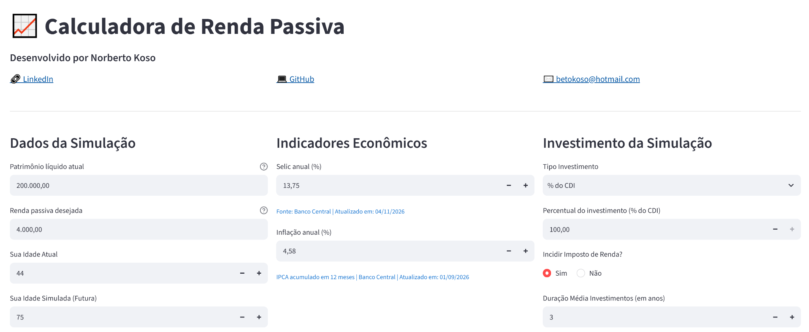
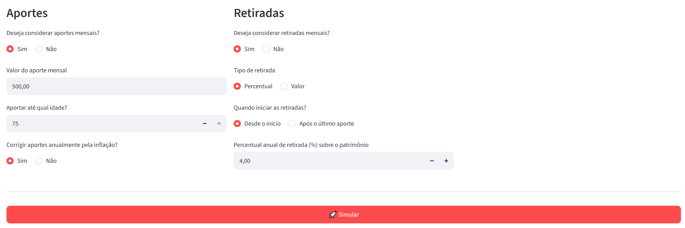
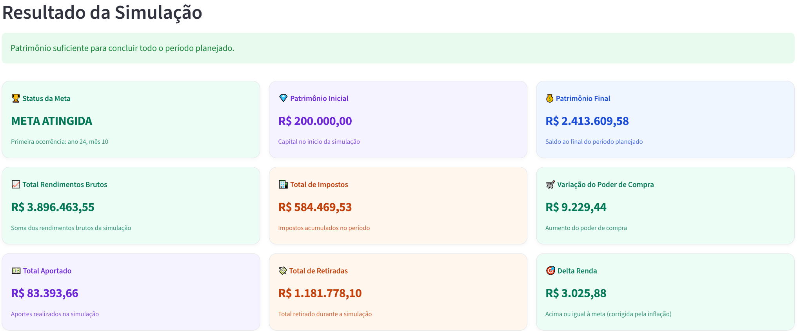
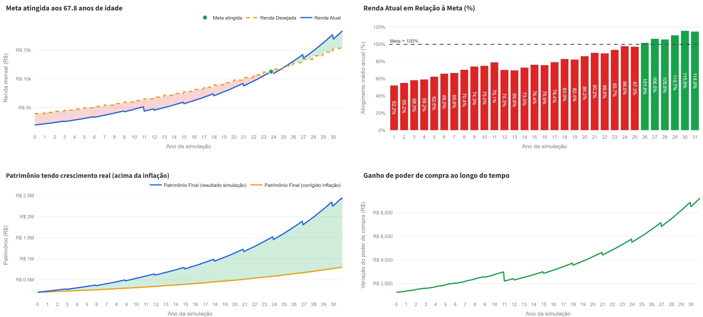
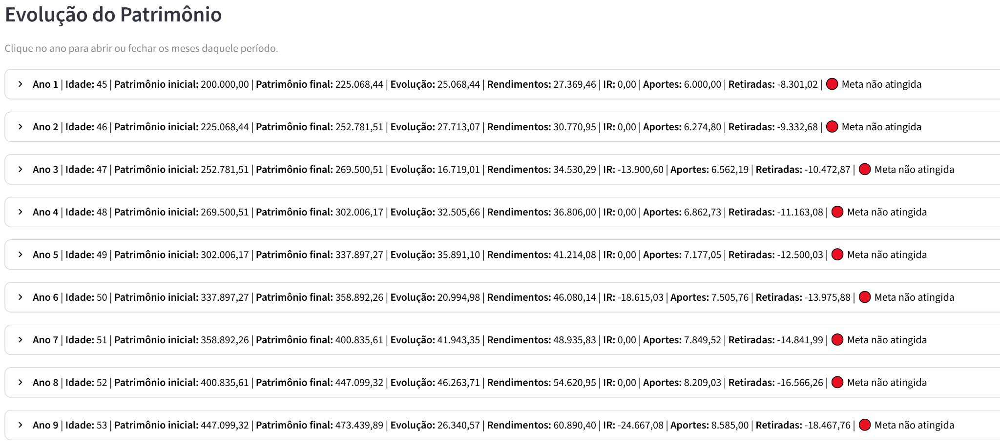
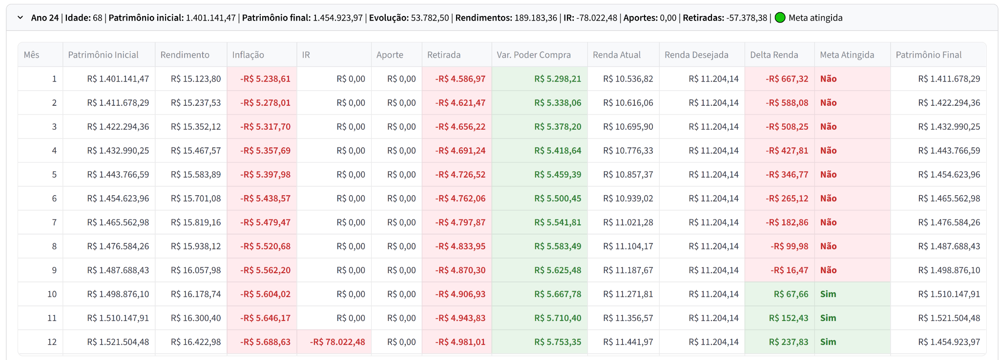

# 📈 Calculadora de Renda Passiva

> Aplicação interativa para explorar cenários de acumulação patrimonial e renda passiva, considerando rentabilidade, inflação, aportes, retiradas e uma estimativa simplificada de Imposto de Renda.

**[▶ Acessar a aplicação](https://calculadorafinanceira.streamlit.app/)** · **[LinkedIn do autor](https://www.linkedin.com/in/norberto-koso-7091a020)**

---

## Visão geral

Planejar renda passiva exige mais do que projetar juros compostos. É necessário avaliar a relação entre patrimônio, rentabilidade, inflação, aportes, retiradas e tributação ao longo do tempo. Uma projeção nominal positiva, isoladamente, não garante ganho de poder de compra.

A **Calculadora de Renda Passiva** transforma essas variáveis em cenários compreensíveis. A simulação mensal permite acompanhar a evolução patrimonial, observar a renda estimada em relação à meta desejada e entender como diferentes premissas alteram o resultado.

## O problema que a aplicação procura responder

- O plano de acumulação e retirada é coerente com a renda desejada?
- Em que momento a renda projetada alcança a meta definida?
- O patrimônio cresce acima da inflação ou apenas aumenta nominalmente?
- Como aportes, prazo de acumulação e início das retiradas alteram o cenário?
- Como interpretar o resultado quando os recursos se tornam insuficientes para sustentar as retiradas?

## Da análise à solução

O projeto parte da **análise do problema antes da escolha das ferramentas**. Primeiro, são identificadas as variáveis relevantes e as perguntas que a simulação deve responder; depois, essas necessidades são traduzidas em regras de negócio e cálculos mensais.

A solução separa a interface, a lógica de cálculo e a obtenção de indicadores econômicos. Os resultados são apresentados por meio de indicadores, gráficos e tabelas, facilitando a comparação de cenários e a interpretação dos efeitos de cada premissa.

Essa abordagem demonstra competências aplicáveis à análise de dados, automação e transformação digital: entendimento do problema, modelagem, definição de regras, tratamento de dados e comunicação de resultados.

## Demonstração da aplicação

### 1. Parâmetros e premissas

O usuário informa patrimônio e renda desejada, idades, indicadores econômicos, tipo de investimento, aportes e retiradas.

### 2. Indicadores e resultados

Os cartões resumem o cenário simulado, incluindo patrimônio inicial e final, rendimentos, impostos, aportes, retiradas e indicadores de poder de compra e meta de renda.

### 3. Gráficos para interpretação

As visualizações ajudam a observar quando a renda estimada alcança a meta e como o patrimônio evolui em termos nominais e em relação à inflação.

### 4. Evolução patrimonial detalhada

A visão anual permite expandir os meses e examinar patrimônio inicial, rendimento, inflação, imposto, aportes, retiradas e patrimônio final.

## Funcionalidades

- **Projeção patrimonial mensal:** acompanha o patrimônio ao longo do horizonte escolhido.
- **Meta de renda passiva:** compara a renda estimada com a meta definida e sua correção pela inflação.
- **Inflação e poder de compra:** oferece referências para analisar o crescimento nominal e real.
- **Tipos de rentabilidade:** permite configurar investimento pré-fixado, percentual do CDI ou IPCA+, conforme as opções implementadas.
- **Aportes configuráveis:** define valor mensal, correção pela inflação e idade limite para contribuir.
- **Retiradas configuráveis:** permite escolher quando começam e se serão calculadas como percentual do patrimônio ou valor definido, com opções de correção.
- **Estimativa de Imposto de Renda:** aplica uma aproximação tributária quando habilitada.
- **Visualização de resultados:** reúne indicadores, gráficos e detalhamento mensal.
- **Análise de insuficiência patrimonial:** permite avaliar a sustentabilidade das retiradas dentro das regras implementadas.

## Tecnologias

| Tecnologia | Papel no projeto |
|---|---|
| Python | Implementação das regras de negócio e cálculos. |
| Streamlit | Interface interativa e publicação da aplicação web. |
| Pandas | Estruturação e organização dos dados da simulação. |
| NumPy | Operações numéricas. |
| Plotly | Gráficos interativos para análise dos resultados. |
| API do Banco Central do Brasil | Consulta de indicadores econômicos usados como referência. |

## Organização dos arquivos Python

A aplicação está organizada em três módulos com responsabilidades distintas:

| Arquivo | Responsabilidade |
|---|---|
| `App.py` | Interface Streamlit: entradas do usuário, validações, execução da simulação e apresentação de indicadores, gráficos e tabelas. |
| `Calculadora.py` | Núcleo de cálculo: regras de negócio, evolução patrimonial mensal, aportes, retiradas, rentabilidade e estimativa de imposto. |
| `API.py` | Integração com fontes de indicadores econômicos, incluindo obtenção de valores de referência de Selic e inflação. |

**Organização dos repositórios:** este repositório público (`Calculadora_Financeira_Doc`) reúne a documentação, a metodologia de cálculo, as limitações do modelo e as imagens da aplicação. O código-fonte da aplicação está em um repositório privado, `Calculadora_Financeira`, e não está disponibilizado publicamente. Os módulos `App.py`, `Calculadora.py` e `API.py` representam a estrutura do código da aplicação, não arquivos presentes neste repositório de documentação. A aplicação pode ser explorada [online](https://calculadorafinanceira.streamlit.app/).

## Como utilizar

1. Acesse a [calculadora publicada](https://calculadorafinanceira.streamlit.app/).
2. Informe patrimônio atual, renda desejada e idades da simulação.
3. Confira os indicadores econômicos apresentados e ajuste as premissas conforme o cenário que deseja analisar.
4. Escolha o tipo de investimento e configure rentabilidade, aportes, retiradas e incidência de imposto.
5. Execute a simulação e analise os cartões, gráficos e a evolução patrimonial mensal.

## Documentação complementar

- [Metodologia de cálculo](metodologia.md) — explica a lógica geral e as premissas utilizadas.
- [Premissas, simplificações e limitações](limitacoes-do-modelo.md) — detalha aproximações, pontos que não são modelados e possíveis evoluções.

## Sobre o projeto

Projeto independente desenvolvido por **Norberto Koso** para demonstrar como um problema prático pode ser estruturado e convertido em uma aplicação orientada por regras de negócio, cálculos e visualização de dados.

- **Aplicação:** [calculadorafinanceira.streamlit.app](https://calculadorafinanceira.streamlit.app/)
- **LinkedIn:** [Norberto Koso](https://www.linkedin.com/in/norberto-koso-7091a020)
- **Repositório de documentação:** [Calculadora_Financeira_Doc](https://github.com/betokoso/Calculadora_Financeira_Doc)

## Aviso importante

Esta aplicação é uma ferramenta de simulação e exploração de cenários. Não constitui recomendação de investimento, consultoria financeira, garantia de rentabilidade ou cálculo oficial de tributos. Os resultados dependem das premissas informadas e devem ser interpretados considerando as limitações do modelo.
